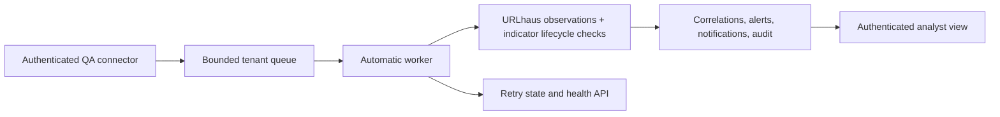

# SICTI Phase 1B — operational correlation and performance QA

**Date:** 9 November 2026\
**Workspace:** `.sicti-flagship-baseline` only\
**Verdict:** Ready for subsequent isolated connector and scale enhancements. The 60-second production SLA is **not established**.

## Implementation

The Phase 1 synchronous QA path remains available. Phase 1B adds an authenticated, tenant-scoped connector contract at `POST /threat-correlations/connector/events`. It accepts the same strict normalized telemetry shape and responds with a receipt/event ID. Only authorized tenant admins with the Threat Intelligence indicator-management feature may submit. A source key is idempotent within a tenant and connector kind; a replay with altered content is rejected with 409. The connector, worker, status, and health APIs require the pilot flags and a `cti_corr_qa_` database name. No external SIEM credential or production integration is configured.

`ThreatEvent` now holds queue state, attempts, retry time, processing timestamps, and failure code. The worker polls every 250 ms, claims up to 20 events using PostgreSQL `FOR UPDATE SKIP LOCKED`, processes at most four concurrently, and retries failures up to three times with bounded backoff. The per-tenant pending/processing queue limit is 500. Stale processing leases are recoverable after 30 seconds. Admins can inspect state counts and oldest pending time; an authorized tenant user can inspect an individual event's result.

For each event, the worker evaluates up to 200 URLhaus feed observations in the five-minute window. It rechecks active/unsuppressed/unexpired indicator eligibility before writing. Each valid observation creates an explainable correlation, alert, notification, and audit entry in one transaction. Multiple observations can produce multiple alerts for one event. The event retains confidence, TLP, source provenance, observed time, ingestion time, processed time, and references to all matches.

## Phase 1B changed files

- `backend/prisma/schema.prisma`
- `backend/prisma/migrations/20261109110000_threat_correlation_queue/migration.sql` (additive; prior migrations preserved)
- `backend/src/correlation/correlation-connector.service.ts`
- `backend/src/correlation/correlation-queue.service.ts`
- `backend/src/correlation/correlation.controller.ts`
- `backend/src/correlation/correlation.module.ts`
- `backend/src/correlation/correlation.dto.ts`
- `backend/src/correlation/correlation.service.ts` (compatibility with one-to-many matches and terminal status)
- `backend/src/correlation/correlation.http.integration.spec.cjs`
- `backend/qa-correlation-performance.cjs`
- `frontend/e2e/correlation-phase1b-browser.cjs`

The existing correlation UI rendered automatic connector results without a component change. Its desktop and mobile views were reviewed visually.

## Validation

| Gate | Result |
|---|---|
| Prisma schema validation and client generation | Passed with local Prisma engines |
| Disposable PostgreSQL migration and seed | 78 migrations applied; passed |
| Backend build | Passed |
| Frontend production build | Passed |
| Backend unit regression | 24 suites, 208 tests passed |
| Correlation HTTP integration | Passed: auth, tenant isolation, default-off gate, multiple observations, replay conflict, invalid URL, delayed event, suppression, retry exhaustion, failure health |
| Existing feed provenance and indicator correlation integrations | 8 tests passed |
| Authenticated Chrome end-to-end | Passed: real login, connector receipt, automatic processing, analyst alert rendering, desktop/mobile screenshots |

## Latency method and results

`backend/qa-correlation-performance.cjs` ran three repetitions of 60 events at concurrency 1, 120 at concurrency 8, and 180 at concurrency 32: **1,080 events total**. Every event matched and exposed alert references through an authenticated status GET. The script measures elapsed time from API event receipt timestamp to the client observing the alert reference, polling at 50 ms. The API separately reports database ingestion-to-processing time and upstream observation-to-receipt delay. All components ran on one Windows host and one disposable PostgreSQL database. The synthetic observation time was set approximately two seconds before submission. Raw results are preserved in [run 1](sicti-correlation-phase1b-performance-run1.json), [run 2](sicti-correlation-phase1b-performance-run2.json), and [run 3](sicti-correlation-phase1b-performance-run3.json).

| Events / concurrency | Run | p50 | p95 | p99 | Max |
|---|---:|---:|---:|---:|---:|
| 60 / 1 | 1 | 995 ms | 1,765 ms | 1,910 ms | 1,910 ms |
| 60 / 1 | 2 | 808 ms | 1,271 ms | 1,317 ms | 1,317 ms |
| 60 / 1 | 3 | 865 ms | 1,318 ms | 1,387 ms | 1,387 ms |
| 120 / 8 | 1 | 1,755 ms | 2,475 ms | 2,506 ms | 2,513 ms |
| 120 / 8 | 2 | 1,305 ms | 1,718 ms | 1,733 ms | 1,734 ms |
| 120 / 8 | 3 | 1,360 ms | 2,208 ms | 2,233 ms | 2,240 ms |
| 180 / 32 | 1 | 3,029 ms | 4,141 ms | 4,173 ms | 4,177 ms |
| 180 / 32 | 2 | 5,108 ms | 7,910 ms | 7,943 ms | 7,947 ms |
| 180 / 32 | 3 | 5,412 ms | 7,599 ms | 7,639 ms | 7,647 ms |

The authenticated browser example observed the alert through the API in **462 ms** from receipt and rendered it on the page in **666 ms**. Its application processing was **362 ms**, while upstream acquisition delay was **97 ms** for that synthetic event. [Desktop screenshot](sicti-correlation-phase1b-desktop.png) · [Mobile screenshot](sicti-correlation-phase1b-mobile.png).

## Limits and readiness

- The connector currently relies on an interactive admin session. A future SIEM integration needs a dedicated tenant-scoped machine credential, rotation, and source-specific controls.
- The test measures local synthetic traffic and authenticated status visibility, not real upstream feed acquisition, browser refresh intervals, production topology, sustained load, fault injection across multiple worker instances, or a contractual 60-second SLA.
- The 60-event p99 is effectively the sample maximum. Three runs show variability at concurrency 32, so larger and longer tests are required before an SLA claim.
- The five-minute exact-match rule and 200-observation processing cap remain. Automatic response actions, predictive ML, and production integrations remain outside scope.
- `alertVisibleAt` is assigned when the alert is created inside the transaction; authenticated GET timing is the observed visibility measure after commit.

Phase 1B is suitable for the next isolated enhancement stage, especially service credentials and production-shaped load/failure tests. It is not approved for production activation by this QA result.
