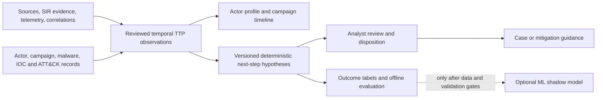

# SICTI Phase 2 — predictive threat actor profiling plan

**Date:** 9 November 2026\
**Scope:** planning only in `.sicti-flagship-baseline`; no Phase 2 code, migration, database change, deployment, or predictive accuracy claim.

## Product intent and boundary

The [Product SISI deck](../../../../Product_SISI.pdf), page 11, asks for actor TTP mapping to MITRE ATT&CK and anticipation of lateral movement or the next attacker step so defenders can act early. The [CTI reference](../../../uiux/CTI.pdf), pages 9 and 12, adds actor aliases, motives, targets, tools, campaign history, confidence, scenario guidance, and analyst validation; pages 29 and 32 place actor profiling before mature predictive analytics. The [four-flagship gap analysis](../../../docs/audits/sicti-four-flagship-capabilities-gap-analysis.md) calls for time-ordered technique evidence, labels, calibrated confidence, abstention, and backtesting. These are requirements, not evidence that a prediction model already works.

The [Phase 1C closure](sicti-phase1c-correlation-development-closure.md) establishes an isolated, tenant-safe exact-IOC correlation path with machine ingestion, evidence, alerts, and synthetic QA. Its 1,440-event benchmark is not a TTP sequence dataset, a production SLA, or evidence of predictive skill. Phase 2 must consume correlation evidence without changing its matching rule, queue, security gates, or alert semantics.

## Current implementation and gap

| Area | Reusable implementation | Phase 2 gap |
|---|---|---|
| Actor profile | `backend/src/intelligence/threat-actors.service.ts` and controller; `ThreatActor` plus `IntelligenceEntity` and graph relationships in `backend/prisma/schema.prisma`; existing actor workspace/panel | Descriptive fields and graph links do not represent when a technique was observed, how actor attribution was established, or an anticipated step. Entity confidence is not calibrated forecast probability. |
| Campaign and ATT&CK | `campaigns.service.ts`, `mitre-techniques.service.ts`, `Campaign`, `MitreTechnique`, and `CampaignMitreTechnique`; campaign/MITRE workspaces | Campaign start/end and technique membership exist, but the join has no observed time, order, evidence pointer, or per-observation confidence. Tactic/platform describe a technique; they do not establish an attack path. |
| Malware and IOC attribution | `malware-tools.service.ts`, actor/campaign malware joins, indicator observations, and `indicators/threat-actor-attribution.service.ts` | Malware associations and IOC actor candidates help profile an actor. Attribution uses weighted matching and analyst confirmation, but an attributed IOC is not proof that an ATT&CK technique happened or that a future step will happen. |
| Source quality | `IntelligenceSource`, `SourceReliabilityAssessment`, `EvidenceCredibilityAssessment`, feed observations, SIR evidence | Existing grades and credibility assessments should be surfaced per observation. No measured mapping from these scores to next-step probability exists. Missing or conflicting provenance must remain visible. |
| Telemetry/correlation | `ThreatEvent` (timestamps, provenance, IOC/IOA fields), `ThreatCorrelation` (event, matched indicator, evidence/alert), correlation service and analyst workspace | `ioaKind` is unstructured; events/correlations do not carry a verified actor, campaign, or ATT&CK technique link. Exact IOC matches cannot be promoted automatically into observed TTP sequences. |
| Review/UI | Threat Actors, Campaigns, MITRE, Malware, IOC discovery, and Correlations pages under `frontend/app/threat-intelligence`; case evidence/review patterns | No actor timeline, candidate next-step explanation, review state, prediction history, or outcome capture. Extend current intelligence navigation and panels before considering a separate module. |

The actor and campaign APIs already resolve tenant scope and use authentication, role, and Threat Intelligence module guards. Phase 2 endpoints should follow these controllers and service patterns. Do not reuse a global actor/technique ID as authorization: every joined row and evidence reference must be checked against the requested tenant.

## Proposed workflow and architecture

1. Ingest or link source evidence into a **candidate observation**. Keep `observedAt` (source-reported occurrence), `ingestedAt`, and review time distinct, with clock uncertainty and original evidence ID. Normalize ATT&CK technique/tactic against the tenant's catalog and preserve source version. An IOC correlation can open a candidate, never certify a technique by itself.
2. An analyst confirms, disputes, or rejects actor/campaign attribution and technique mapping. The profile shows aliases, motives, targets, related malware, IOC links, campaign history, ATT&CK coverage, and the provenance of each claim. Do not merge aliases or campaigns solely by name similarity.
3. Build a directed, time-ordered path from confirmed observations. Nodes are observed techniques with tactic and time interval; edges represent **observed order within a campaign**, with the actual time gap and evidence. Allow parallel or uncertain ordering. ATT&CK tactic order or an analyst-authored transition rule is a hypothesis, clearly distinguished from an observed edge. Do not infer lateral movement from a technique label alone.
4. Run a versioned deterministic hypothesis engine against an actor/campaign snapshot. Candidate next techniques come from documented transition rules, recent confirmed TTPs, campaign context, and optional actor history. Return evidence links, rule version, supporting and conflicting observations, scope and time window, and an explicit **insufficient evidence** outcome. Label outputs “next-step hypotheses” until prospective or retrospective validation supports a predictive claim.
5. Analysts can accept for investigation, dismiss, mark already observed, or record an outcome later. A reviewed hypothesis may inform a case or mitigation suggestion; it must not trigger autonomous prevention or change Phase 1C correlation alerts.

### Minimal data and API contracts for implementation design

Prefer additive, tenant-owned records linked to existing models over duplicating actor, campaign, technique, source, or correlation tables. Proposed contracts are design targets, not migrations in this phase:

| Contract | Required fields and invariants |
|---|---|
| `TtpObservation` | `tenantId`, stable ID/idempotency key, actor/campaign/technique IDs where known, observed interval and timestamp precision, ingested/reviewed times, source/evidence reference and immutable source snapshot or digest, attribution basis, status (`CANDIDATE/CONFIRMED/DISPUTED/REJECTED`), reviewer/reason, source reliability snapshot, ATT&CK catalog version. At least one source pointer; nullable actor until confirmed. Evidence and linked records must share tenant. |
| `NextStepRun` | `tenantId`, actor/campaign scope, as-of cutoff, horizon, input snapshot/version, engine and rule/model version, creation time, abstention reason, run status. Immutable after publication; no information observed after cutoff may enter its inputs. |
| `NextStepCandidate` | Parent run, technique/tactic, rank, **heuristic support score** (not probability), support and counterevidence observation IDs, rule trace, assumptions, recommended check/mitigation, validity window. Multiple candidates are allowed; none when abstaining. |
| `NextStepReview` and outcome | Candidate ID, tenant, analyst, disposition, reason, review timestamp, later observed outcome with evidence and occurrence time, label quality (`VERIFIED/UNCERTAIN/UNOBSERVABLE`), assessment timestamp. Append-only changes or audit history; a dismissal is not ground truth that the step did not occur. |

Suggested read APIs extend the actor/campaign detail surface: scoped timeline; profile evidence summary; run/candidate history; explanation detail; and review/outcome commands. Generation should be an explicit admin or analyst action or a bounded job with idempotency, audit logging, pagination, rate limits, and feature gating. Define exact write roles with the existing Threat Intelligence permissions before implementation; regular users can receive tenant-scoped, TLP-filtered read views only. A run must not disclose RED evidence through a lower-privilege explanation. Cross-tenant IDs, hidden sources, and stale review versions return safe errors. Preserve source TLP and retention/deletion behavior through derived records.

### Confidence and explainability

Keep separate fields for (a) source reliability, (b) evidence credibility, (c) actor attribution confidence, (d) technique mapping confidence, and (e) hypothesis support. Each has its own provenance and meaning. A transparent deterministic score can weight recency, independent corroboration, source reliability, specificity, and contradictory evidence, but must expose component values, caps, and rule version. Multiple copies of one feed are one evidence lineage, not independent corroboration. Missing source provenance, disputed attribution, ambiguous timing, or insufficient campaign context should lower support or force abstention. Do not display `75% likely` until a calibrated model and validation justify probability semantics.

## Data readiness and ground truth gate

Code and schema inspection confirms storage **capability**, not the number or quality of historical tenant records. No database audit was run for this planning task. Before any model work, run read-only, tenant-scoped inventory queries in an approved QA copy and report: actors/campaigns with confirmed technique observations; observations with occurrence time and evidence; sequential campaign paths of length at least two; independent source lineages and assessed reliability; missing/contradictory timestamps; tenant distribution; later verified outcomes and observation windows; ATT&CK version drift; analyst disagreement; data retention and TLP constraints. Separate real history from seeded/synthetic Phase 1C fixtures. Publish counts and missingness without cross-tenant disclosure.

Define ground truth as a later, independently evidenced technique for the same campaign within the predeclared horizon, adjudicated by an analyst. “No observed step” is censored or unknown unless monitoring coverage can support a negative label. Actor alias changes, campaign merges, imported retrospective reports, and late-arriving telemetry must be time-stamped so a backtest uses only information available at its as-of time. If sufficient independent, ordered, labeled history is absent, stay with descriptive profiles and deterministic hypotheses; do not train or advertise ML.

## Evaluation and release gates

Freeze a temporal train/validation/test split and a held-out prospective period. Keep campaigns and duplicate source lineages from leaking across splits; report actor-held-out and tenant-specific results separately where sample size permits. Compare against simple predeclared baselines: most common next technique, recent campaign technique frequency, and explicit tactic-transition rules. Use the same candidate universe and horizon for every method. Record sample counts and uncertainty intervals; do not pool tenants to hide weak cohorts.

Measure top-1/top-3 precision and recall on verified outcomes, mean reciprocal rank, abstention coverage and risk, false hypotheses per analyst per week, lead time before verified step, review burden, and explanation completeness. For a model that emits probabilities, also measure Brier score and calibration error with reliability plots; deterministic support scores are excluded from probability-calibration claims. Measure missingness and disagreement separately. A model advances beyond shadow mode only if it beats the strongest baseline on the held-out period with a predeclared meaningful margin, acceptable calibration and false-alert burden, and no material tenant/TLP/security failure. Set numeric product thresholds after the readiness inventory and analyst capacity baseline, then freeze them **before** the final test. This avoids inventing accuracy targets without data.

## Phased implementation roadmap

| Phase | Work | Exit gate |
|---|---|---|
| 2A — evidence foundation | Approved data inventory; contract review; additive temporal TTP observation and evidence linkage; tenant/TLP guards; actor/campaign timeline in existing UI; analyst confirmation and audit | Every confirmed observation has occurrence interval, provenance, ATT&CK mapping/version, reviewer, tenant-safe references; ambiguous data stays candidate. Existing V1/V2 and Phase 1C regression suites pass. |
| 2B — explainable hypotheses | Versioned deterministic rules and snapshots, attack-path view, abstention, candidate history, review/outcome capture, case handoff as guidance | Every displayed candidate has rule trace and evidence/counterevidence; rerunning the same snapshot/version is reproducible; no automatic blocking or “predictive accuracy” language. |
| 2C — retrospective/prospective validation | Label adjudication, leakage-safe backtest, baseline comparisons, shadow monitoring, predeclared thresholds | Report sample sizes, cohort results, uncertainty, analyst burden, lead time, and abstention. If data are inadequate, remain at 2B and collect outcomes. |
| 2D — optional predictive ML | Only after 2C gate: offline model, feature/time/version registry, probability calibration, tenant isolation, drift and rollback plan, shadow comparison | Held-out and prospective evidence demonstrates improvement over strongest baseline and meets frozen product/security criteria before any broader release or prediction claim. |

### Realistic end-to-end QA and measurable acceptance

Use a disposable QA tenant pair and synthetic fixture sequences for functional/security tests; use independently labeled real history only for predictive evaluation. Do not treat fixture success as accuracy evidence.

1. **Observed path:** create or import a campaign with two time-stamped, source-backed techniques and one uncertain concurrent event. Confirm two observations; timeline orders known events, marks ambiguity, and opens exact evidence. Reject an unsupported technique; it never enters the confirmed path.
2. **Hypothesis and abstention:** run at an as-of cutoff. Candidate output includes version, evidence, conflict, horizon, and non-probabilistic support. Repeat same input/version and compare identical ranked results. A sparse or disputed-only campaign returns an abstention with reason and no candidate.
3. **Late evidence and leakage:** ingest an observation with occurrence before but ingestion after the cutoff. Historical run stays unchanged; a new run may include it only under the declared availability rule. Backtest must never read its post-cutoff content.
4. **Review and outcome:** analyst accepts one candidate for investigation and later attaches independently verified occurrence evidence; another is dismissed without being counted as a negative label. Review and outcome history retain actor, version, reviewer, timestamps, and audit records.
5. **Isolation and disclosure:** tenant B cannot read or mutate tenant A's observations, runs, reviews, or evidence by guessed ID; regular user cannot see RED explanation content or issue privileged generation/review commands. Assert safe 403/404 behavior and no cross-tenant rows in list APIs.
6. **Regression:** run existing actor/campaign/indicator and Phase 1C correlation integration/browser paths. Exact IOC matching, queue retry, credentials, correlation alert count, and analyst visibility remain unchanged. New hypothesis generation creates no Phase 1C alert and makes no prevention call.
7. **Operational bounds:** test pagination and idempotent generation, bounded candidate count, concurrent reviews/version conflict, missing source deletion/retention, and run failure recovery. Capture p95 API/run latency and per-tenant job cost in QA; agree limits from representative inventory before release.

**Recommended first development task, after separate authorization:** implement Phase 2A's smallest vertical slice: tenant-scoped, evidence-linked temporal `TtpObservation` contract and analyst confirmation, exposed in the existing actor/campaign detail timeline. First perform the read-only readiness inventory and settle the observation/review schema and ATT&CK version mapping; then build one observation-to-timeline path with cross-tenant, TLP, ambiguous-time, and unsupported-attribution tests. This creates the trustworthy sequence needed by every later hypothesis or model.

## Planning limits

This is a source/code audit, not a live data audit. Historical counts, ground-truth availability, source quality, acceptable forecast horizon, analyst capacity, and performance budgets remain to be measured. No Phase 2 implementation or database change was performed.
